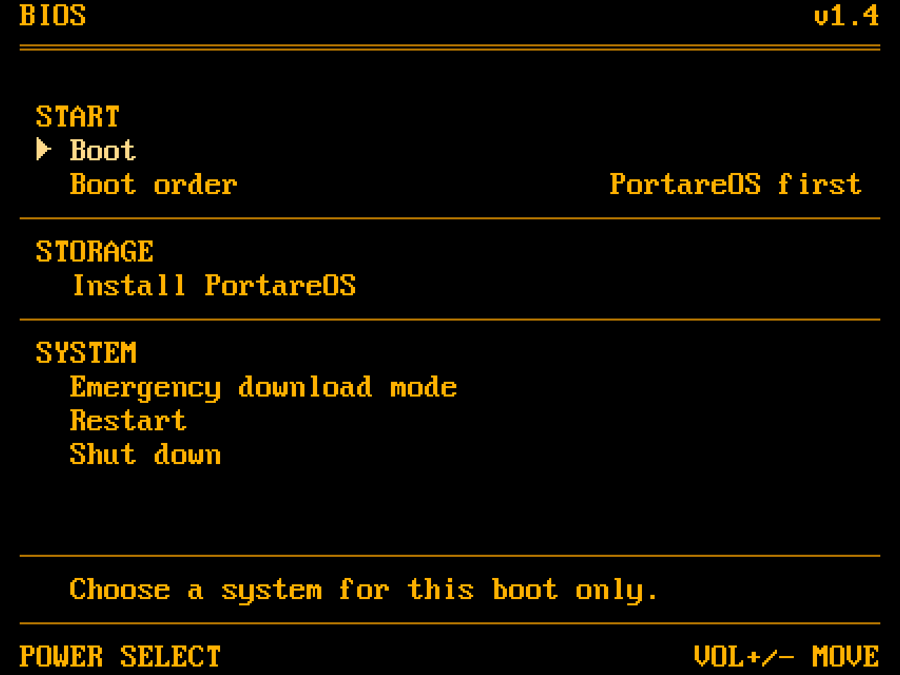
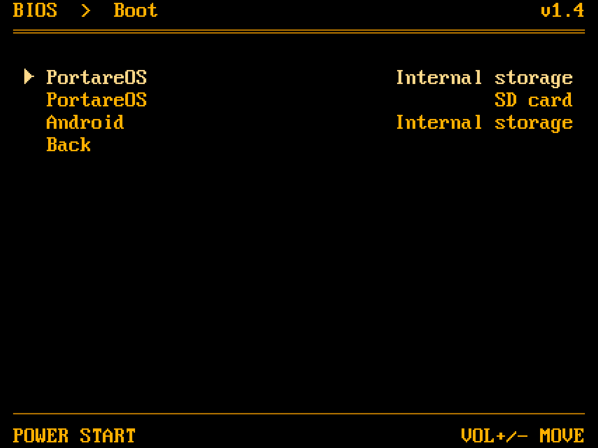

# Portare BIOS

Portare BIOS is the BIOS for the Retroid Pocket Nova. It boots PortareOS,
ArmadaOS, ROCKNIX and Android, and installs PortareOS from an SD card to
internal storage.

<p>
  
  
</p>

## Installing BIOS

Download `abl_signed-SM8550.elf` from the
[releases](https://github.com/portare-ch/BIOS/releases). Boot into fastboot
with ABL flashing unlocked, then flash both slots:

```bash
fastboot flash abl_a abl_signed-SM8550.elf
fastboot flash abl_b abl_signed-SM8550.elf
fastboot reboot
```

For bootloader recovery on the Nova through Qualcomm EDL mode, see the
[Nova recovery kit](https://github.com/portare-ch/nova_recovery).

## Using it

Hold a volume key while powering on to change how the Nova starts:

| Held | What happens |
|---|---|
| Nothing | Boots the default system (Linux initially). A failed start opens the menu. |
| Volume Down | Opens the BIOS menu, with fastboot available over USB. |
| Volume Up | Boots Android, or Android recovery if Android is the default. |

`fastboot reboot bootloader` or a keyboard's Delete key also opens the menu.

In the menu, use Volume Up and Down to move and Power to select.
**Boot** chooses a system for this boot; **Boot order** changes the default
when Android is installed. **Linux first** tries internal storage, then
the SD card; the boot list lets you choose an individual installation.
PortareOS, ArmadaOS and ROCKNIX appear by name with their storage location.

Linux installations need a FAT boot volume with `KERNEL`, an Android boot
image (header v0 to v2) containing the Nova's device tree. The BIOS keeps
the image's full command line, including ArmadaOS's root and OSTree
arguments and ROCKNIX's `boot=` and `disk=` arguments. Boot volumes labelled
`PORTAREOS`, `ARMADA` and `ROCKNIX` are recognized; older ArmadaOS volumes
labelled `ROCKNIX` are identified by their `.armada-bootimg.id` stamp.
Other bootable `KERNEL` volumes appear as **Linux**.

Support covers existing SD-card and internal installations using this
layout. Images that use only BLS entries or EFI loaders need a compatible
`KERNEL` image. Use each distribution's installer for ArmadaOS or ROCKNIX;
the BIOS installer installs PortareOS.

Enable the charging screen with `fastboot oem off-mode-charge 1` (`0`
disables it). On that screen, Power boots the default system, a volume key
opens the menu, and unplugging the charger turns the Nova off.

## Installing PortareOS

Insert a PortareOS SD card and choose **Install PortareOS** in the menu.
The card needs a FAT volume labelled `PORTAREOS` with `KERNEL` and `SYSTEM`.

- **Dualboot** keeps Android and lets you choose how much space it keeps.
  The first install resets Android, erasing its apps and data. Reinstalling
  PortareOS alongside Android preserves PortareOS's games, saves and settings.
- **Replace Android** erases Android and any existing PortareOS installation,
  including their data, and gives PortareOS all the space.

The menu shows the storage allocation and asks for confirmation before
writing. After installation, restart to boot PortareOS from internal storage.

## Building

Requires git, zip, and a running Docker engine or Apple's `container`.

```bash
./build.sh sm8550
```

The BIOS image and recovery ZIP are written to `build/out/`; the build log
is at `build/abl-build.log`. Add `--clean` to build from scratch.

To preview the menu screens, use the simulator (requires a C compiler and zlib):

```bash
make sim
build/sim/openabl-menu-sim
```

Screenshots are written to `build/screens/`.

Run `Scripts/test.sh` to test the installer in a container, or `make test`
locally with dosfstools, mtools and e2fsprogs installed.

## Licence

Portare BIOS is a fork of OpenABL by the Open Handheld Collective, licensed
under [GPL-3.0-or-later](LICENSE) with a linking exception for `Abl/`.
See [licences](LICENSES.md) and [credits](CREDITS.md).
